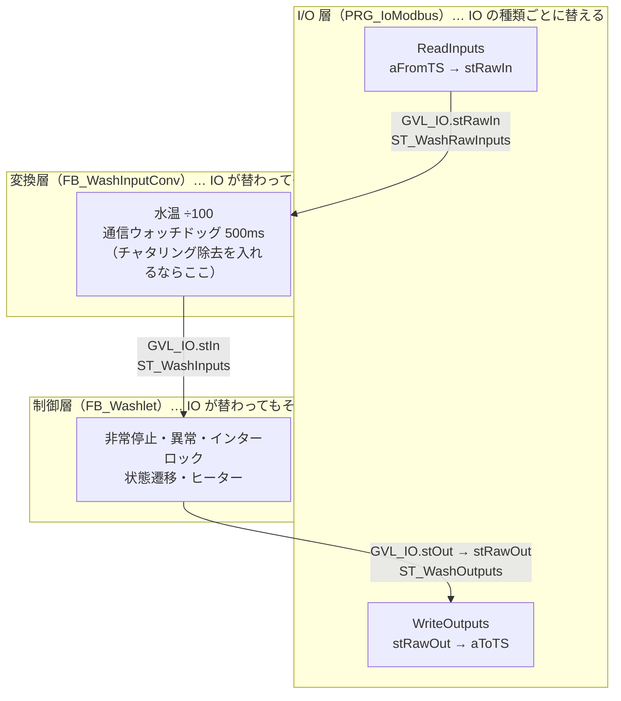
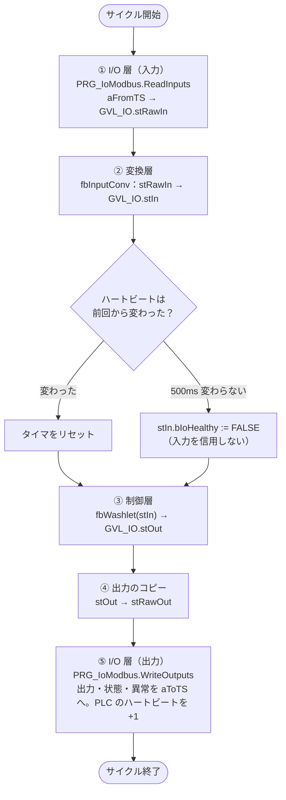
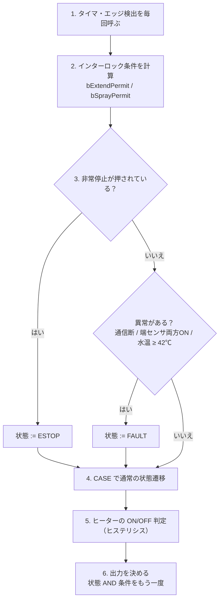
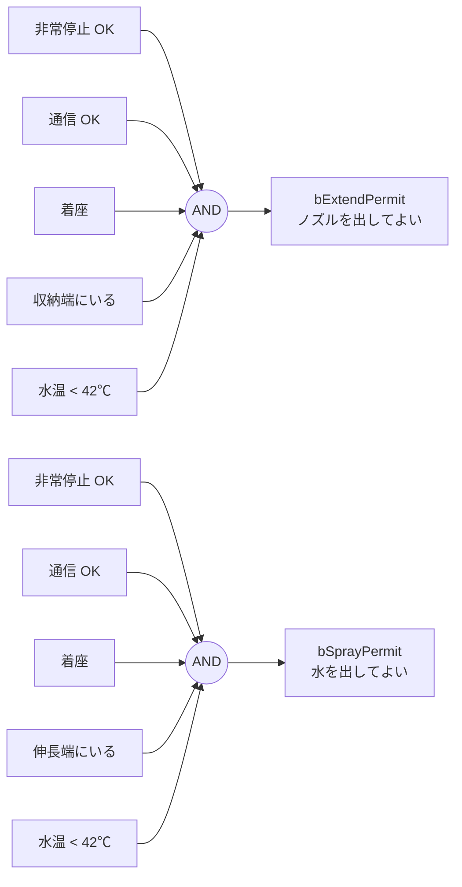
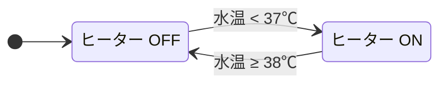
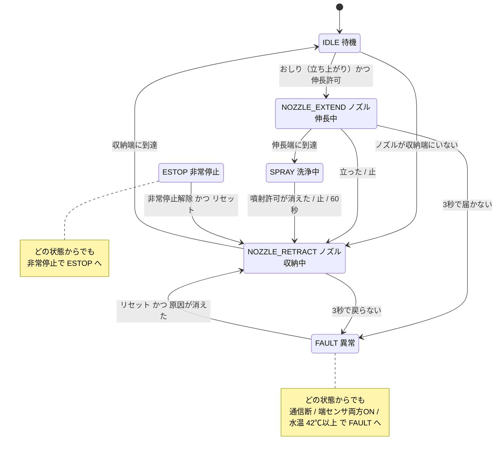
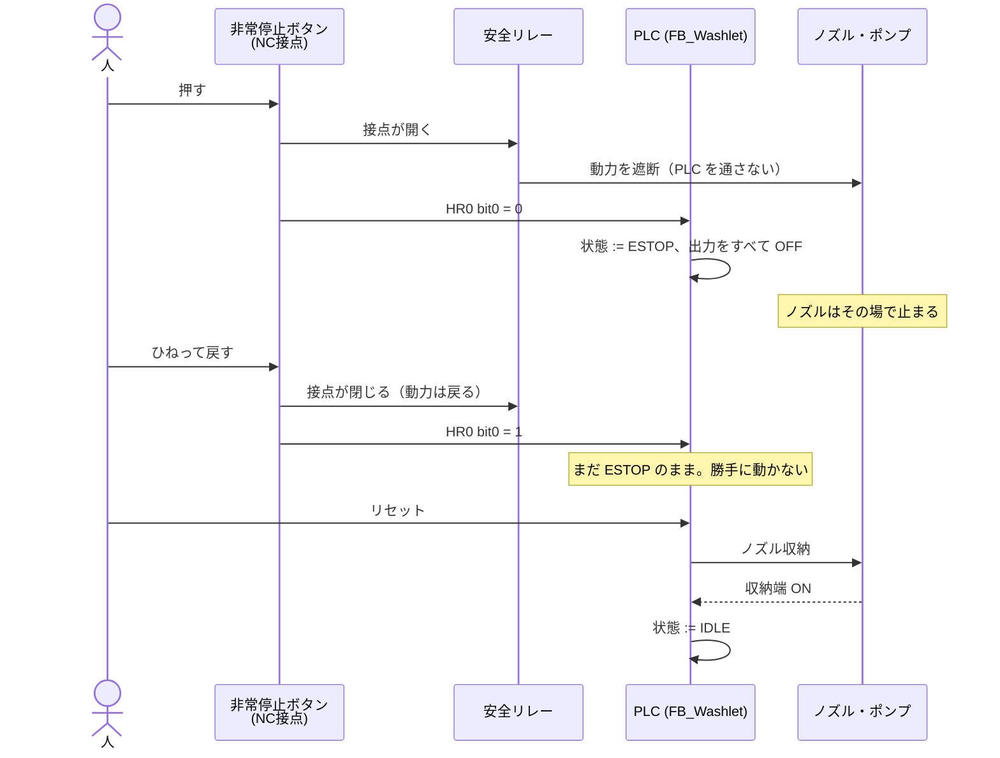

# CODESYS 側コード解説

MOMO-WASH 3000 の PLC 側（`codesys/src/`）を、図を中心にざっくり説明する。
図は Mermaid で書いてあるので、GitHub や VS Code のプレビューでそのまま表示できる。

## 1. 全体像：PLC は「判断係」

PLC はセンサを読んで、出力を返すだけ。ノズルが動く、お湯が温まるといった物理は Web 側の機械モデルが持つ。

```mermaid
flowchart LR
    subgraph WEB["Web 側（機械モデル）"]
        SENS["センサ・ボタン<br/>非常停止 / 着座 / 端センサ / 水温"]
        ACT["アクチュエータ<br/>ノズル / ポンプ / ヒーター"]
        HW["PLC の外の安全回路<br/>安全リレー / 温度ヒューズ"]
    end
    subgraph PLC["CODESYS"]
        IO["PRG_IoModbus<br/>I/O 層：詰め替え"]
        CONV["FB_WashInputConv<br/>変換層：換算・通信の見張り"]
        FB["FB_Washlet<br/>制御層：判断"]
    end
    SENS -- "HR0〜HR2" --> IO
    IO --> CONV
    CONV --> FB
    FB --> IO
    IO -- "IR0〜IR5" --> ACT
    HW -. "PLC と関係なく動力を切る" .-> ACT
```



ポイントは、安全リレーと温度ヒューズが **PLC の外** にあること。PLC が壊れても、バグっていても、ここで止まる。

## 2. ファイルの役割

| ファイル | 種類 | 役割 |
|---|---|---|
| `E_WashState.st` | 列挙型 | 状態（IDLE / NOZZLE_EXTEND / SPRAY / NOZZLE_RETRACT / ESTOP / FAULT） |
| `E_WashAlarm.st` | 列挙型 | 異常の理由（最初の1件だけ残す） |
| `ST_WashRawInputs.st` | 構造体 | IO から来る生の値（ボタン・センサの BOOL、水温 ×100、ハートビート） |
| `ST_WashInputs.st` | 構造体 | 制御が使う値（水温 [℃]、通信 OK を含む 9 つ） |
| `ST_WashOutputs.st` | 構造体 | 機械を動かす出力 4 つ（伸長・収納・ポンプ・ヒーター） |
| `GVL_Modbus.st` | GVL | Modbus のレジスタ配列（`aFromTS` = HR、`aToTS` = IR） |
| `GVL_IO.st` | GVL | 層の間の受け渡し（`stRawIn` / `stIn` / `stOut` / `stRawOut`） |
| `PRG_IoModbus.st` | プログラム | I/O 層。Modbus 配列 ⇔ `stRawIn` / `stRawOut`。アクション `ReadInputs` / `WriteOutputs` |
| `FB_WashInputConv.st` | FB | 変換層。水温の換算、通信ウォッチドッグ |
| `FB_Washlet.st` | FB | 制御層。非常停止・異常・インターロック・状態遷移・ヒーター制御 |
| `PLC_PRG.st` | プログラム | 層を順に呼ぶだけ |

## 3. 層に分ける：差し替えるのは I/O 層だけ

PLC の中を 3 つの層に分けてある。狙いは、Web の機械モデルから実機の IO ユニットに替えるとき、**I/O 層だけを書き換えれば済む** ようにすること。



- 実機にするときは `PRG_IoModbus` を外し、`GVL_IO.stRawIn` / `stRawOut` を IO ユニットの I/O マッピングに割り当てる
- 生の値（`stRawIn`）と制御が使う値（`stIn`）を分けておくと、「IO からは何が来ているか」と「FB は何を見て判断したか」を別々にモニタできる
- `FB_Washlet` の入力は `stIn` 1 本（VAR_INPUT）。数十バイトと小さく、呼んだ時点の値がコピーされるので 1 サイクルの間は値が変わらない
- アクチュエータは `stOut` にまとめ、状態の出力（`eState` / `eAlarm` / 許可）は個別のまま残す。「機械を動かす出力」と「状態を知らせる出力」を分けるため
- `GVL_IO` の各変数を書くのは 1 か所だけ（`stRawIn` は `PRG_IoModbus`、ほかは `PLC_PRG`）

## 4. PLC_PRG：1サイクルの流れ

PLC は 10ms ごとに、上から下まで1回ずつ実行する。順番が大事。



- 通信の見張り（ウォッチドッグ）は「Web 側が毎回 +1 する数字が止まったら、ケーブルが抜けたとみなす」仕組み
- 入力が止まると、センサの値は「最後に見えた値」のまま固まる。座っていないのに「座っている」と見え続けるかもしれないので、信用せずに止める
- ウォッチドッグは変換層にある。実機の IO ユニットでも「入力が生きているか」の判断は要るので、I/O 層ではなく変換層に置いた（実機では、IO ユニットの通信状態のビットなどを使う形に替える）

## 5. FB_Washlet：中は6段構え

FB の中も上から順に実行する。**止める判断が、動かす判断より先** に来るのが肝。



### 1. タイマとエッジ検出は毎回呼ぶ

```
tonExtend(IN := eState = E_WashState.NOZZLE_EXTEND, PT := T_EXTEND_TIMEOUT);
```

- `IF` の中で呼ぶと、呼ばれないサイクルにタイマがリセットされず、2回目から即タイムアウトしたりする
- 「いつ数えるか」は `IN` に条件を書いて決める
- ボタンは `R_TRIG`（立ち上がりエッジ）で見る。押しっぱなしで何度も反応しないように

### 2. インターロック条件を名前つきで計算

「この動作をしてよいか」を、先に1本の BOOL にまとめておく。



名前をつけておくと、Modbus で公開して画面の「PLC の気持ち」に出せる。「なぜ動かないか」が一目で分かる。

### 3. 非常停止と異常は CASE の前で割り込む

- どの状態にいても、ここで ESTOP / FAULT に飛ぶ
- CASE の各状態に書き散らすと、状態を足したときに書き忘れる。入口で1回だけ判定すれば漏れない
- 異常の理由（`eAlarm`）は **最初の1件だけ** 残す。連鎖して出る2件目で上書きすると、本当の原因が分からなくなる

### 4. 状態遷移（6 章で図にする）

### 5. ヒーターはヒステリシスで制御

37℃ 未満で ON、38℃ 以上で OFF。間の 37〜38℃ は「今の状態を保つ」。



1つのしきい値だけだと、38℃ 付近で ON/OFF を高速に繰り返してリレーが傷む。幅（ヒステリシス）を持たせるのはそのため。

### 6. 出力は「状態 AND 条件」で二重にかける

```
stOut.bPump := eState = E_WashState.SPRAY AND bSprayPermit;
```

- 状態遷移にバグがあって SPRAY のまま残っても、立った瞬間に `bSprayPermit` が FALSE になりポンプは止まる
- 出力を書くのはこの1か所だけ。誰が止めたか追いやすい
- ヒーターは ESTOP 中と FAULT 中も OFF。「解除しただけでは何も動かさない」を徹底する

## 6. 状態遷移図



読み方のコツ:

- **普段の流れ** は IDLE → 伸長 → 洗浄 → 収納 → IDLE の輪
- **立つ・止・60秒** は異常ではない。「正常な停止」として収納に向かう。リセットはいらない
- **ESTOP と FAULT からの出口は、必ず NOZZLE_RETRACT**。続きから再開せず、まずノズルを引っ込める（安全側の動作から始める）
- FAULT は、原因が残っている間はリセットを受け付けない（例：お湯が冷めるまで待つ）
- CASE の `ELSE`（想定外の値）も FAULT に落とす。来てはいけない場所に来たら止める

## 7. 異常の一覧

| 異常（E_WashAlarm） | いつ出る | リセットできる条件 |
|---|---|---|
| ESTOP_PRESSED | 非常停止が押された・配線が切れた | 非常停止を戻してからリセット |
| EXTEND_TIMEOUT | ノズルが 3 秒で伸びきらない | リセットで収納から再試行 |
| RETRACT_TIMEOUT | ノズルが 3 秒で戻らない | 同上 |
| NOZZLE_SENSOR_BOTH | 伸長端と収納端が同時に ON | センサが直ってから |
| WATER_OVER_TEMP | 水温が 42℃ 以上 | 42℃ 未満に冷めてから |
| IO_LINK_LOST | 機械からの入力が 500ms 途絶えた | 通信が戻ってから |
| INVALID_STATE | 状態が想定外の値 | リセット |

## 8. 非常停止を押したときの流れ

ハード（安全リレー）が先に動力を切り、PLC はあとから状態を合わせる。PLC は「後始末係」。



## 9. まとめ

- PLC は判断だけ。物理と最後の安全装置（安全リレー・温度ヒューズ）は外にある
- PLC の中は I/O 層・変換層・制御層の 3 つ。IO を替えるときは I/O 層だけを替える
- 止める判断は CASE より先。非常停止と異常は入口で1回だけ見る
- インターロックは名前つきの BOOL にして、遷移と出力の2か所でかける
- 非常停止・異常からの再開は、リセット操作のあと、安全側（ノズル収納）から
- タイマとエッジ検出は毎サイクル呼ぶ
